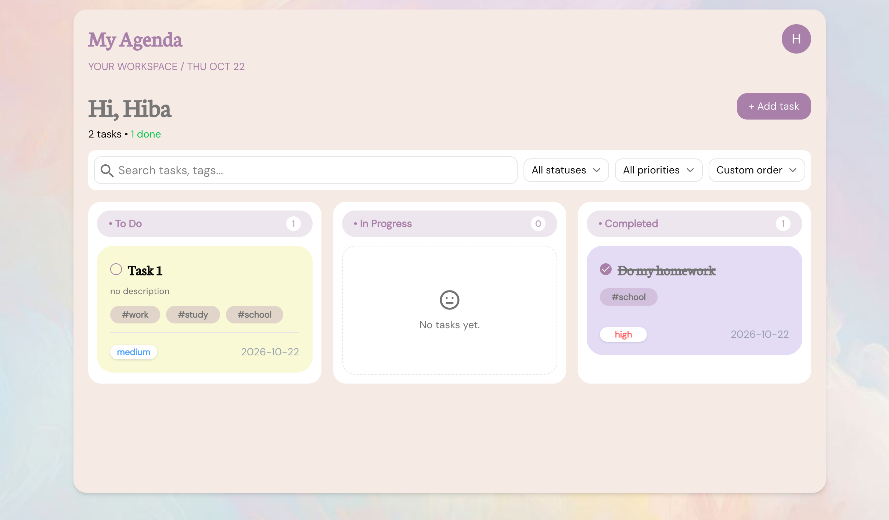
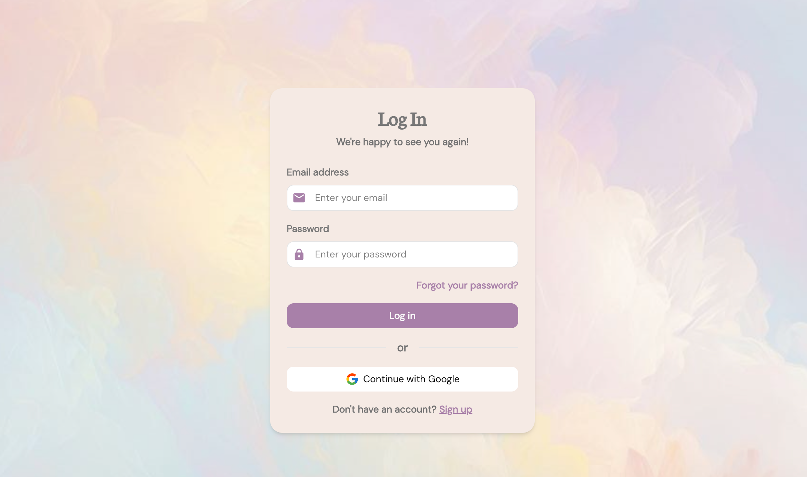
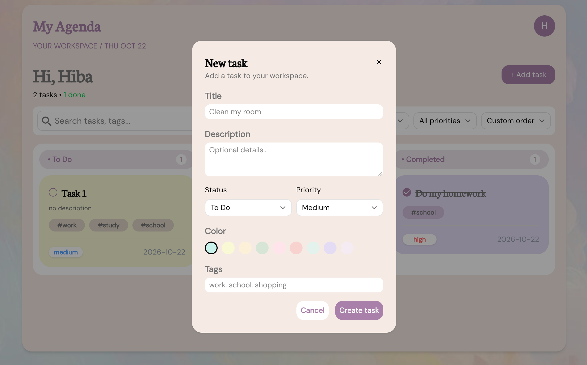

# My Agenda 

A task management application built to help users organize tasks, manage priorities, and track their progress through a clean, intuitive interface.

## Live Demo

[View Live Demo](https://my-agenda-sand.vercel.app)

## Preview

### Dashboard


### Login


### Task Modal


## Features

- **Authentication:** Email/password and Google OAuth.
- **Task Management:** Create, edit, delete, and organize tasks by status and priority.
- **Search & Sorting:** Search by title or tags, filter by status and priority, and sort tasks.
- **Form Validation:** Zod and React Hook Form.
- **Security:** Supabase Row Level Security (RLS).
- **User Experience:** Responsive design, toast notifications, and loading, error, and empty states.

## Tech Stack

- **Frontend & UI:** Next.js, React, TypeScript, Tailwind CSS, shadcn/ui, React Icons
- **Backend & Authentication:** Supabase, PostgreSQL, Google OAuth
- **Data Fetching & Forms:** TanStack React Query, React Hook Form, Zod
- **Deployment:** Vercel

## Getting Started

### Installation

1. Clone the repository:

   ```bash
   git clone https://github.com/Hibaz108/My-Agenda.git
   ```

2. Navigate to the project directory:

   ```bash
   cd My-Agenda
   ```

3. Install dependencies:

   ```bash
   npm install
   ```

4. Create a `.env.local` file in the root directory and add your Supabase credentials:

   ```env
   NEXT_PUBLIC_SUPABASE_URL=your_supabase_project_url
   NEXT_PUBLIC_SUPABASE_PUBLISHABLE_KEY=your_supabase_public_key
   ```

   Replace the placeholder values with your actual Supabase project credentials.

5. Start the development server:

   ```bash
   npm run dev
   ```

6. Open [http://localhost:3000](http://localhost:3000) in your browser.